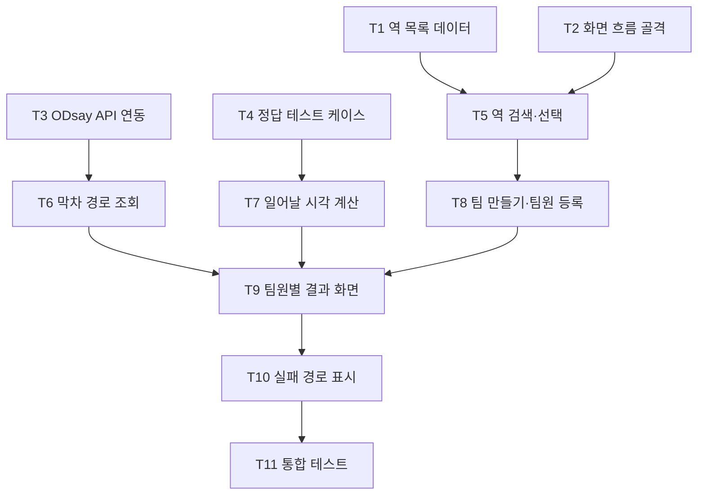

# 5주차 활동지 / Week 5 Worksheet

**1-page 기획서 / One-page plan**

- 작성일 / Date: 26.10.3
- 참여자 / Present: 박현준, 손민석, 이주현, 오지현

## ① 주제 확정 / Confirm topic

- **확정 주제 / Topic:** 막차연산알림 (술자리 귀가용 지하철 막차 기준 "일어날 시각" 역산 서비스, 이번 학기는 수도권 지하철에 집중)
- **이유 / Reason:** 지도앱은 "지금 출발하면" 기준의 경로만 보여줘서, 술집에서 역까지의 도보 시간, 환승, 중간 종착열차(예: 구파발행)를 반영한 **실제로 일어나야 할 시각**은 사용자가 직접 계산해야 한다. 술자리 분위기 때문에 계산을 미루다 막차를 놓치면 택시비 등 금전적 손해로 이어진다. 술자리(팀)를 만들고 각자 도착역만 등록하면, 팀원 개개인이 몇 시에 역으로 출발해야 하는지와 집까지 걸리는 시간을 한 화면에서 함께 볼 수 있게 하고자 한다.

### 핵심 사용 흐름 / Core user flow

1. 메인화면 진입
2. **팀(술자리) 만들기:** 팀명 입력 + 지금 술 마시고 있는 곳과 가장 가까운 지하철역(출발역) 검색·선택 + 요일 구분(평일/토요일/휴일, 오늘 날짜로 자동 선택·수정 가능)
3. **팀원 등록:** 팀원마다 이름 + 집(또는 가야 할 곳)과 가장 가까운 지하철역(도착역) 등록. 술집→출발역 도보 시간(기본 7분)과 여유 시간(기본 5분)은 필요하면 수정
4. [계산하기] 선택
5. **결과 화면:** 팀원별로
   - **역으로 출발해야 할 시각(일어날 시각, HH:MM)**
   - **예상 소요 시간** (일어난 시각부터 도착역 도착까지: 도보 + 승차 + 환승)
   - 탑승할 열차 정보(출발 시각, 환승역)

   를 일어날 시각이 빠른 순으로 표시

> 팀명과 출발역이 없으면 [다음] 버튼이, 팀원이 1명도 없으면 [계산하기] 버튼이 비활성화된다.
> Must 단계에서는 한 기기에서 팀원들이 돌아가며 자기 도착역을 입력한다. 각자 휴대폰에서 링크로 들어와 입력하는 방식은 Should.

---

## ② 태스크 분해와 의존 관계 / Tasks and dependencies

### 태스크 목록 / Task list

| # | 태스크 Task | 완료 조건 Done when | 선행 태스크 Depends on | 담당 Owner |
|---|---|---|---|---|
| T1 | 지하철 역 목록 데이터 정리 | 수도권 지하철 역명, 노선, ODsay 역 ID가 JSON 파일 1개로 저장되고, "홍대", "대화"처럼 일부만 입력해도 찾을 수 있도록 역명이 정리됨 | - | 오지현 |
| T2 | 화면 흐름 골격 제작 | 메인 → 팀 만들기 → 팀원 등록 → 결과 화면까지 버튼으로 이동되고, 팀명·출발역이 없으면 [다음], 팀원이 0명이면 [계산하기]가 비활성화됨 | - | 이주현 |
| T3 | ODsay API 연동 확인 | API 키 발급 후 경로 검색·지하철 시간표 호출이 성공하고, 5초 안에 응답이 없으면 실패로 처리하는 호출 함수가 저장소에 올라감 | - | 박현준 |
| T4 | 정답 테스트 케이스 작성 | 실제 경로 5개 이상(홍대입구→대화 포함, 환승 경로·중간 종착열차가 있는 경로 각 1개 이상)에 대해 막차 열차 출발 시각, 정답 일어날 시각, 예상 소요 시간을 직접 역산한 목록 파일이 올라감 (3주차 2-2 직접 해보기 결과 활용) | - | 손민석 |
| T5 | 역 검색·선택 입력칸 | 역 이름 일부를 입력하면 T1 목록에서 후보가 뜨고 선택할 수 있으며, 목록에 없는 역은 선택되지 않음 | T1, T2 | 오지현 |
| T6 | 막차 경로 조회 함수 | 출발역, 도착역, 요일을 넣으면 도착역까지 실제로 가는 마지막 경로(탑승 열차 출발 시각, 환승역, 승차·환승 시간)를 돌려주고, 도착역까지 가지 않는 중간 종착열차는 사유("목적지 미도달")와 함께 제외 목록으로 분리함 (AC-2) | T3 | 박현준 |
| T7 | 일어날 시각·소요 시간 계산 함수 | **일어날 시각 = 탑승 열차 출발 시각 − 도보 시간 − 여유 시간**, **예상 소요 시간 = 도보 + 여유 + 승차 + 환승**을 돌려주는 함수가 T4 케이스를 모두 통과함. 현재 시각이 마지막 열차 출발 시각을 지났으면 `MISSED`를 돌려줌 (AC-1, AC-4) | T4 | 손민석 |
| T8 | 팀 만들기·팀원 등록 화면 | 팀명, 출발역, 요일 구분을 입력하고, 팀원(이름 + 도착역)을 추가·삭제할 수 있음. 도보 7분·여유 5분이 기본으로 채워지고 수정 가능함 | T5 | 오지현 |
| T9 | 팀원별 결과 화면 | [계산하기] 후 3초 이내에 팀원별 일어날 시각, 예상 소요 시간, 탑승 열차 정보가 일어날 시각 오름차순으로 표시됨 (예: 22:30 → 22:56 → 23:10). 한 명의 값을 바꾸면 순서가 즉시 갱신됨 (AC-1, AC-3) | T6, T7, T8 | 이주현 |
| T10 | 실패 경로 표시 | 막차를 놓친 팀원은 시각 대신 `MISSED`와 "오늘 막차를 놓쳤습니다", API 실패·5초 초과 시 "경로를 불러오지 못했습니다. 다시 시도해 주세요"와 [다시 시도] 버튼, 제외된 중간 종착열차는 사유와 함께 표시되고 이전 결과는 남지 않음 (AC-2, AC-4, AC-5) | T9 | 이주현 |
| T11 | 시연 시나리오 통합 테스트 | 정상 흐름(팀원 3명)과 실패 경로(막차 놓침, API 실패, 중간 종착열차)를 처음부터 끝까지 3회 연속 오류 없이 실행하고 AC-1~AC-5를 모두 확인함 | T10 | 손민석 |

### 의존 관계 그래프 / Dependency graph (DAG)

- **지금 착수 가능 (진입 차수 0) / Can start now (in-degree 0):** T1, T2, T3, T4
- **작업 순서 (위상정렬) / Work order (topological sort):** T1 → T2 → T3 → T4 → T5 → T6 → T7 → T8 → T9 → T10 → T11
- **사이클이 있었다면 어떻게 풀었는가 / If there was a cycle, how did you fix it?:** 사이클 없음. 처음에는 "팀원 등록 화면"에서 등록하자마자 각자의 일어날 시각을 보여주려고 해서, 등록 화면은 결과 계산을, 결과 화면은 등록 데이터를 서로 필요로 하는 것처럼 보였다. 등록 화면(T8)은 입력만 저장하고, 결과 화면(T9)은 저장된 데이터를 읽어 계산만 하도록 나눴다. 또 계산 함수(T7)는 API 없이 "열차 출발 시각"만 받도록 경로 조회(T6)와 분리해, API 연동이 끝나기 전에도 T4 정답 케이스로 먼저 테스트할 수 있게 했다.

---

## ③ 범위 결정 / Scope

### Must — 없으면 성립 안 됨 / essential

- **핵심 시나리오 / Core scenario:** 메인화면에서 팀명과 술자리 근처 지하철역(출발역)을 등록하고, 팀원들이 각자 집과 가장 가까운 지하철역(도착역)을 등록한 뒤 [계산하기]를 누르면, 팀원별로 역으로 출발해야 할 시각(일어날 시각)과 집까지 예상 소요 시간이 빠른 순으로 화면에 표시된다. 막차를 놓쳤거나 경로를 불러오지 못하면 시각 대신 안내 문구를 보여준다.
  - 해당 태스크: T1 ~ T11 전체
  - 실패 경로(T10)도 Must에 넣은 이유: 경로를 못 불러왔는데 엉뚱한 시각을 보여주면 그 시각을 믿고 막차를 놓치게 되므로, 틀린 시각보다 "모른다"고 알려주는 쪽이 서비스가 성립하는 조건이다.

### Should

- **시나리오 / 링크로 각자 입장:** 팀을 만들면 팀 코드(링크)가 생기고, 팀원이 각자 휴대폰에서 링크로 들어와 자기 이름과 도착역을 등록하면 팀 결과 화면에 바로 반영된다. (팀 데이터는 당일 지나면 삭제)
- **시나리오 / 일어날 시각 임박 표시:** 결과 화면에서 각자 일어날 시각까지 남은 시간이 카운트다운으로 표시되고, 10분 이내가 되면 해당 팀원 행이 강조된다. (푸시 알림 대신 화면 내 표시)
- **시나리오 / 막차 대안 경로 비교:** 막차 1개만이 아니라 막차 직전 열차 1~2개도 함께 보여줘, 조금 일찍 일어나면 환승이 덜한 경로를 고를 수 있다.

### Could

- **시나리오 / 현재 위치로 출발역 자동 추천:** 위치 권한을 허용하면 현재 위치에서 가장 가까운 지하철역을 출발역 후보로 먼저 보여준다.
- **시나리오 / 도보 시간 자동 계산:** 술집 이름이나 주소를 입력하면 출발역까지의 도보 시간을 지도 API로 계산해 기본값 7분 대신 채운다.
- **시나리오 / 같은 방향 친구 묶기:** 같은 열차를 타는 팀원끼리 묶어 "같이 나가면 되는 사람"으로 표시한다.
- **시나리오 / 막차 놓친 사람 대안 안내:** `MISSED`인 팀원에게 심야버스 등 대안 교통을 안내한다.

### Won't — 이번 학기에 안 함 / not this semester

| Won't 항목 Item | 포기한 이유 Why |
|---|---|
| 푸시 알림 발송 | 앱 설치와 알림 서버가 필요해 웹 앱 범위를 넘음. 결과 화면의 카운트다운·강조 표시(Should)로 대체 |
| 버스·택시 경로 | MVP는 지하철 전용(3주차 결정). 버스는 노선·배차가 훨씬 많아 막차 역산 검증 범위가 커짐 |
| 실시간 열차 지연 반영 | 막차 판단은 시간표 기준으로 하고, 지연 가능성은 여유 시간(기본 5분)으로 흡수함 |
| 친구 실시간 위치 공유 | 3주차에서 짚은 대로 친구가 자기 위치 공유에 동의하지 않았을 수 있음. 정확한 위치나 집 주소 대신 "가장 가까운 역 이름"만 받음 |
| 수도권 외 지역 지하철 | 지역마다 시간표·데이터 형식이 달라 검증할 테스트 케이스를 만들기 어려움. 수도권만 지원 |
| 회원가입·로그인 | 술자리 한 번 쓰고 끝나는 서비스라 계정이 필요 없고, 개인정보 저장만 늘어남 |

### 실행 가능성 확인 / Feasibility check

- **특수 장비·유료 API·실제 개인정보가 필요한가? 대안은?**
  - 특수 장비: 필요 없음. 노트북과 휴대폰 브라우저만 사용.
  - 유료 API: 경로·시간표는 ODsay 무료 키를 사용한다. 무료 호출량을 아끼기 위해 개발 중에는 같은 역 조합의 응답을 저장해 재사용하고, 시연용 경로의 응답도 미리 저장해 둔다.
  - 실제 개인정보: 집 주소나 현재 위치 대신 **가장 가까운 지하철역 이름**만 입력받는다. 이름은 별명으로 입력해도 되며, Must 단계에서는 서버에 저장하지 않고 화면에서만 사용한다. (Should의 링크 입장 기능에서는 팀 데이터를 당일 삭제)
- **15주차에 발표장에서 시연할 수 있는 형태인가?**
  - 가능. 웹 앱을 노트북이나 휴대폰 브라우저에서 실행해 시연한다.
  - 발표 시간(낮)에는 막차까지 시간이 많이 남아 결과가 와닿지 않으므로, **현재 시각을 직접 지정하는 시연 모드**(예: 23:30)를 둔다. AC-4 테스트(현재 시각 23:55 입력)에도 같은 기능을 쓴다.
  - 발표장 네트워크나 API가 불안정할 경우를 대비해 저장해 둔 응답으로도 같은 흐름을 보여줄 수 있게 하고, API 실패 경로(AC-5)도 함께 시연한다.

---

## ④ 가장 먼저 동작시킬 흐름 (Walking Skeleton) / First end-to-end flow

**[팀명과 출발역(홍대입구), 팀원 1명의 도착역(대화)을 입력하면]** → **[도착역까지 가는 막차 열차를 조회해(예: 23:08 출발) 도보 7분·여유 5분을 빼서]** → **[화면에 "박현준 · 22:56에 일어나기 · 예상 소요 OO분"이 나온다]**

> ODsay 연동(T3, T6)이 아직 안 되어 있으면 열차 출발 시각은 T4 정답 케이스 값으로 임시로 넣고, 입력 → 계산 → 결과 표시가 먼저 끝까지 이어지게 만든다.
