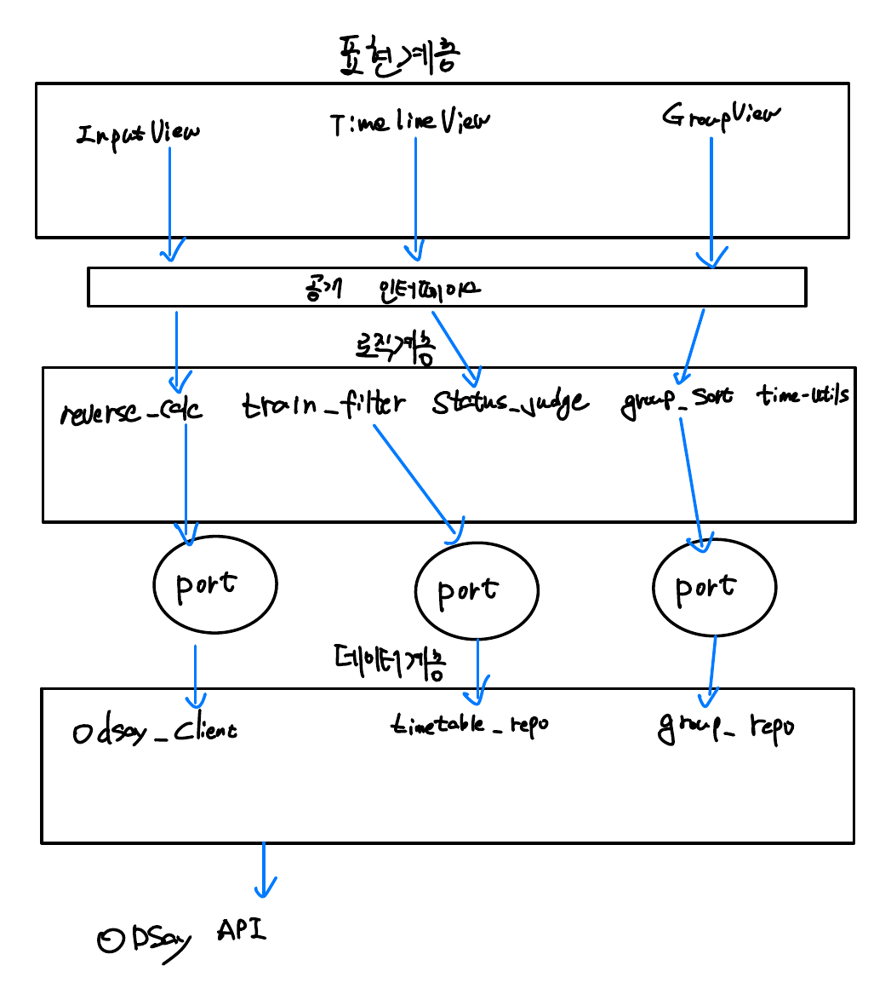

# Week 07 팀 활동지 / Team Activity

| 팀명 / Team | 작성일 / Date | 참여자 / Members |
|---|---|---|
|xia |2026-10-26 |박현준,손민석,오지현,이주현 |

## 1. 아키텍처 다이어그램 / Architecture Diagram

손그림 사진을 올리고 링크하십시오 / Upload a photo and link it.



> MVP(Must)는 **1인 기준 막차 계산**입니다. 팀 기능(팀명, 여러 명 입력, 일어날 시각 정렬)은 Could 1순위로, MVP 완료 직후 `team_sort`·`team_repo`와 팀 화면을 추가합니다. 그림에서는 점선 박스로 표시했습니다.

| 계층 / Layer | 모듈·파일 / Modules | 의존하지 않는 것 / Does not depend on |
|---|---|---|
| 표현 / Presentation | 입력 화면(출발역·도착역·요일 구분·도보/여유 시간), 결과 화면(일어날 시각·예상 소요 시간·상태 문구), 구간 타임라인(탑승 열차·환승역·구간별 시각) / *Could: 팀 화면* | ODsay API 직접 호출, 시간표·역 목록 데이터 형식, 역산 계산 내부 로직 |
| 로직 / Logic | `time_utils`(분↔HH:MM 변환), `reverse_calc`(막차 역산·예상 소요 시간 계산), `train_filter`(종착 열차 제외), `status_judge`(OK/SOON/NOW/MISSED 판정) / *Could: `team_sort`(팀원 일어날 시각 정렬)* | UI 프레임워크, ODsay 응답 JSON 구조, 저장소 종류(DB 등) |
| 데이터 / Data | `station_repo`(지하철 역 목록·역 검색), `odsay_client`(경로 검색 API 연동), `timetable_repo`(요일별 시간표 조회) / *Could: `team_repo`(팀명·팀원 정보 저장)* | UI 화면 구성, 역산 계산 규칙, 상태 판정 기준 |

## 2. 이슈 / Issues

> 이슈 = **앞으로 할 일** / An issue is work to be done.
> 개발할 때 커밋에 이슈 번호를 붙이고(`#3 알레르기 필터 추가`), 완료 조건을 만족하면 이슈를 닫습니다.
> Add the issue number to commits, and close the issue when its criteria are met.

| # | 제목 / Title | 라벨 / Label | 담당 / Assignee | 완료 조건 / Acceptance Criteria |
|---|---|---|---|---|
| #1 | 시간 변환 유틸 | backend | 손민석 | `23:12`는 1392분, 다음 날 `00:30`은 1470분으로 변환되고, 1470분은 화면에 `00:30`으로 표시된다 |
| #2 | ODsay 지하철 경로 검색 연동 | data | 박현준 | 출발역과 도착역을 넣으면 환승역과 구간(노선·출발역·도착역·소요 시간)이 담긴 경로 목록이 반환되고, 5초 안에 응답이 없거나 호출이 실패하면 실패 결과가 반환된다 |
| #3 | 요일별 시간표 조회 | data | 박현준 | `WEEKDAY`, `SATURDAY`, `HOLIDAY`를 넘기면 각각 다른 시간표가 반환되고, 오늘 날짜가 공휴일이면 `HOLIDAY`가 기본으로 선택된다 |
| #4 | 막차 역산·예상 소요 시간 계산 | backend | 손민석 | 막차 출발 23:08, 도보 7분, 여유 5분을 넣으면 일어날 시각이 22:56(1376분)으로 계산되고, 승차·환승 시간 합이 50분인 경로면 예상 소요 시간(도보+여유+승차+환승)이 62분으로 계산된다 |
| #5 | 종착 열차 제외 | backend | 손민석 | 목적지(대화역)에 도달하지 못하는 L3 23:45 구파발행이 후보에서 빠지고 `excludedTrains`에 제외 사유("목적지 미도달")가 기록된다 |
| #6 | 상태 판정 | backend | 이주현 | 현재 시각 기준으로 일어날 시각이 지났으면 `MISSED`, 같으면 `NOW`, 10분 이내로 남았으면 `SOON`, 그 외는 `OK`로 판정된다 |
| #7 | 지하철 역 검색 | data | 오지현 | "홍대", "대화"처럼 역 이름 일부를 넣으면 수도권 역 목록에서 후보(역명·노선)가 반환되고, 목록에 없는 역 이름은 선택되지 않는다 |
| #8 | 입력 화면 | frontend | 오지현 | 출발역(술자리와 가장 가까운 역)과 도착역(집과 가장 가까운 역)을 역 검색으로 선택하고, 요일 구분(오늘 날짜로 자동 선택·수정 가능)과 도보·여유 시간(기본 7분·5분, 수정 가능)을 입력할 수 있으며, 출발역이나 도착역이 비어 있으면 [계산하기] 버튼이 비활성화된다 |
| #9 | 구간 타임라인 | frontend | 오지현 | 결과 화면에서 탑승할 열차의 출발 시각, 환승역, 구간별 출발·도착 시각이 순서대로 표시되고, 제외된 중간 종착열차가 있으면 사유와 함께 표시된다 |
| #10 | **[Could] 팀 기능** | feature | 이주현 (MVP 후) | 팀명을 입력하고 여러 명의 도착역을 등록하면, 각자의 일어날 시각이 빠른 순으로 한 화면에 표시된다 (22:56, 22:30, 23:10 → 22:30, 22:56, 23:10). 한 명의 값을 바꾸면 순서가 다시 정렬된다. 입력 방식(한 사람이 대신 입력 / 각자 입장)은 착수 전에 정한다 |
| #11 | 결과 화면 | frontend | 이주현 | [계산하기] 후 3초 이내에 일어날 시각, 예상 소요 시간, 탑승 열차가 표시되고, 도보·여유 시간을 바꾸면 결과가 그만큼 달라진다. `MISSED`이면 "오늘 막차를 놓쳤습니다", 경로 조회 실패면 "경로를 불러오지 못했습니다. 다시 시도해 주세요"와 [다시 시도] 버튼이 시각 대신 표시된다 |
| #12 | 실행 패키지 정리 | docs | 박현준 | README만 보고 처음 보는 사람이 앱을 설치하고 실행해 출발역·도착역을 넣고 한 번 계산까지 해볼 수 있다 |

## 3. 마일스톤 / Milestones

| 마일스톤 / Milestone | 마감 / Due | 포함 이슈 / Issues |
|---|---|---|
| MVP 완료 (1인 막차 계산) | 11주차 | #1, #2, #3, #4, #5, #6, #7, #8, #9, #11 |
| 팀 기능 (Could 1순위) | MVP 완료 직후 | #10 |
| 실행 패키지 | 13주차 | #12 |

## 4. 레포 구조 / Repository Structure

> 아키텍처의 세 계층이 폴더로 그대로 나뉘도록 구성했습니다. 화면은 `frontend/`, 로직·데이터는 `backend/logic/`, `backend/data/`에 두고, 각 파일 옆 번호는 담당 이슈입니다. `(Could)` 표시 파일은 MVP 이후 #10에서 추가합니다.

```
xia-makcha/
├── README.md                    # 설치·실행 방법, 시연 모드 사용법 (#12)
├── PROMPTS.md                   # AI 사용 기록
├── .env.example                 # ODSAY_API_KEY=, HOLIDAY_API_KEY= (실제 키는 .env, 커밋 금지)
├── .gitignore                   # .env, node_modules/, __pycache__/
│
├── docs/                        # 주차별 활동지
│   ├── week-03-candidate-B.md
│   ├── week-04.md
│   ├── week-05.md
│   ├── week-07.md
│   └── img/
│       └── week-07-arch.png
│
├── frontend/                    # 표현 계층
│   ├── index.html
│   └── src/
│       ├── api.js               # backend 계산 API 호출 (ODsay를 직접 부르지 않음)
│       ├── pages/
│       │   ├── InputPage            # 입력 화면 (#8)
│       │   ├── ResultPage           # 결과 화면 (#11)
│       │   └── TeamPage             # (Could) 팀 화면 (#10)
│       └── components/
│           ├── StationSearch        # 역 검색 입력칸 (#7, #8)
│           └── RouteTimeline        # 구간 타임라인 (#9)
│
└── backend/
    ├── main.py                  # 계산 API 라우트, 시연 모드(now 지정) 처리
    ├── requirements.txt
    ├── logic/                   # 로직 계층: UI·ODsay 응답 형식을 모름
    │   ├── time_utils.py        # #1
    │   ├── reverse_calc.py      # #4
    │   ├── train_filter.py      # #5
    │   ├── status_judge.py      # #6
    │   └── team_sort.py         # (Could) #10
    ├── data/                    # 데이터 계층: 계산 규칙을 모름
    │   ├── station_repo.py      # #7
    │   ├── odsay_client.py      # #2
    │   ├── timetable_repo.py    # #3 (공휴일 판정 포함)
    │   └── team_repo.py         # (Could) #10
    ├── resources/
    │   ├── stations.json        # 수도권 역 목록 (역명·노선·ODsay 역 ID)
    │   └── odsay_cache/         # 개발·시연용으로 저장해 둔 API 응답
    └── tests/
        ├── cases.json           # 정답 케이스 (홍대입구→대화 등, 직접 역산한 값)
        ├── test_time_utils.py
        ├── test_reverse_calc.py
        ├── test_train_filter.py
        └── test_status_judge.py
```

- **의존 규칙:** `frontend` → `backend/main.py` → `logic` → `data` 방향으로만 부른다. `logic`은 `data`가 넘겨준 값(열차 출발 시각, 구간 목록)만 받아서, ODsay 응답 JSON이 바뀌어도 `odsay_client.py`만 고치면 된다.
- **1인 → 팀 확장:** 팀 기능은 1인 계산(`reverse_calc`)을 사람 수만큼 반복한 뒤 `team_sort`로 정렬하는 구조라, MVP 코드를 고치지 않고 파일을 추가하는 것만으로 붙일 수 있다.
- **테스트:** `logic/`의 함수는 API 없이 `tests/cases.json` 값만으로 테스트한다. 이슈의 완료 조건(예: 23:08 출발 → 22:56)을 그대로 테스트 케이스로 옮긴다.

> AI를 사용했다면 `PROMPTS.md`에 기록 / Log any AI use in `PROMPTS.md`
